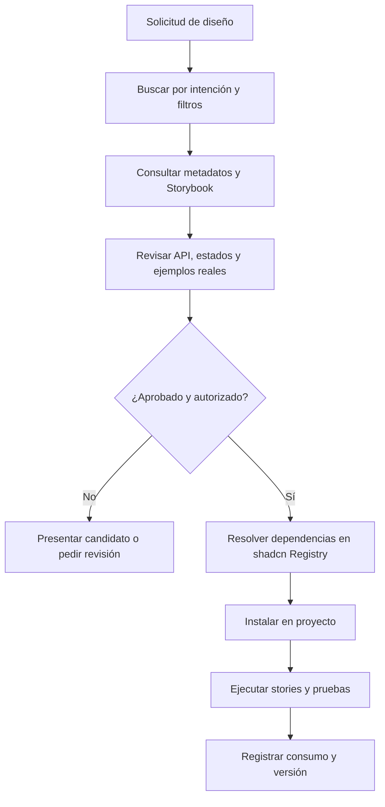

# Bibliotecas de diseño reutilizables: cómo registrar componentes, colores y animaciones para humanos y agentes

**Fecha de investigación:** 16 de octubre de 2026  
**Caso de aplicación:** REA Reuse · Presentaciones FALP  
**Resultado:** investigación, arquitectura, ejemplos de código ejecutable, concepto de sitio REA Atlas y límites de validación.

> **Pregunta rectora:** Si un modelo observa una página web o una captura y reconstruye su diseño, ¿qué debemos almacenar para que después una persona o un agente pueda **encontrar, inspeccionar, comprender, reutilizar y verificar** sus componentes sin volver a reconstruirlos?

## Resumen ejecutivo

La biblioteca no debería consistir solo en archivos `.tsx` ni en capturas bonitas. Debe preservar cinco dimensiones de cada elemento: **identidad visual**, **comportamiento**, **contrato de uso**, **procedencia** y **estado de verificación**.

La investigación identifica una combinación particularmente adecuada:

1. **DTCG Design Tokens** para valores visuales independientes de React: colores, dimensiones, tipografía, duraciones y curvas.
2. **Storybook** para catálogo visual, controles interactivos, estados, historias, documentación y consulta de componentes por agentes a través de MCP.
3. **shadcn Registry** para describir componentes instalables, archivos, dependencias y distribución desde GitHub, incluidos repositorios privados.
4. **Recetas de movimiento propias** para representar aquello que los tokens no cubren: disparadores, estados, keyframes, coordinación, cancelación, interrupciones y comportamiento ante movimiento reducido.
5. **Capa de evidencia y procedencia de REA Reuse** para enlazar el original con cada reconstrucción, registrar decisiones inferidas y demostrar fidelidad mediante pruebas.

**Decisión principal:** comenzar con GitHub como fuente de verdad, Storybook como catálogo humano y de agentes, y shadcn como mecanismo de distribución. No construir de entrada una base vectorial, backend de catálogos ni un MCP propio que duplique estas capacidades.

**Actualización v1.1:** se incorpora un kit local con código React/TSX, Storybook, DTCG, scripts de búsqueda y registry, además de una maqueta de REA Atlas inspirada en referencias de Awwwards. Se distingue entre pruebas locales aprobadas, herramientas pendientes de instalación y la comparación visual FALP aún no realizada.

---

## 1. Alcance y método

Esta investigación contrasta especificaciones oficiales y documentación de herramientas que cubren diferentes partes de un sistema de diseño. Se revisan, entre otras, DTCG, Style Dictionary, Storybook, shadcn/ui, Carbon Design System, Motion, Web Animations API y Playwright. Como referencias de exploración visual se consideran React Bits y Aceternity UI.

Se distingue entre:

- **Hecho documentado:** capacidad respaldada por la documentación oficial enlazada.
- **Inferencia de diseño:** solución razonable derivada de combinar capacidades, no necesariamente implementada por una herramienta existente.
- **Propuesta propia:** esquema o convención que requerirá implementación y pruebas en REA Reuse.

Los ejemplos de metadatos y animaciones de este documento son **contratos propuestos**, no salidas verificadas de una extracción automática. Los valores ilustrativos no deben interpretarse como mediciones del sitio FALP.

### Fuentes clave y función

| Sistema | Qué registra o permite hacer | Implicación para la biblioteca |
|---|---|---|
| DTCG Design Tokens Format 2025.10 | Especificación JSON con `$type`, `$value`, referencias y tipos de token. Es un informe del Community Group, no una Recomendación W3C. | Formato interoperable para los fundamentos. |
| Style Dictionary | Transformación de tokens a salidas de plataforma; soporte DTCG, con limitaciones declaradas para el formato 2025.10. | Adaptadores CSS/Tailwind sin editar manualmente artefactos derivados. |
| Storybook (CSF, Args, Docs, MDX) | Historias, variantes, propiedades editables, documentación, pruebas de interacción. | Catálogo que una persona pueda explorar y modificar. |
| Storybook MCP y manifests | Descubrimiento de componentes, propiedades y ejemplos por agentes; funciones de prueba según configuración. Las API para agentes están en *preview*. | Evitar inventar props e integrar documentación con agentes. |
| shadcn Registry | Manifiestos, dependencias, archivos y distribución; repositorios GitHub como registries, públicos o privados. | Instalación reutilizable y auditable. |
| Carbon Motion | Diferencia entre movimiento productivo y expresivo, y guías de uso. | Documentar intención del movimiento, no solo parámetros. |
| Motion for React | Transiciones temporizadas, físicas (*springs*), gestos y secuencias. | Implementación de recetas complejas. |
| Web Animations API | Consulta de animaciones activas, estados y keyframes expuestos por el navegador. | Captura parcial y objetiva del comportamiento de una página. |
| Playwright | Pruebas visuales y snapshots con opciones de animación. | QA visual determinista separado del QA temporal. |
| React Bits / Aceternity UI | Galerías explorables de componentes y efectos, con demos y código. | Referentes de descubribilidad visual, no autoridad normativa. |

Las fuentes exactas se encuentran al final de este documento.

---

## 2. Distinción arquitectónica: seis familias de información

Una pantalla es una composición, no necesariamente un componente. Una captura puede mostrar la pantalla completa, pero no revela por sí sola propiedades, estructura o estados interactivos. Por lo tanto, el extractor debe producir objetos tipados.

| Familia | Qué conservar | Fuente canónica recomendada | Vista humana |
|---|---|---|---|
| **Foundations** | Colores, gradientes, tipografía, sombras, radios, espacios, puntos de quiebre, opacidades. | `*.tokens.json` (DTCG). | Paleta y guía de estilos. |
| **Components** | JSX/TSX, props, variantes, slots, estados, semántica, dependencias. | `.tsx` + JSDoc y tests. | Historia Storybook con controles. |
| **Patterns & layouts** | Composición de varios componentes, reglas de distribución, responsividad y propósito de tarea. | TSX + stories + documentación MDX. | Vista de patrón/página completa. |
| **Motion** | Duración y easing reutilizable; recetas de disparadores, estados y keyframes. | Tokens DTCG + `motion/*.json`. | Demo reproducible, timeline, video. |
| **Assets** | Iconos, SVG, logotipos, imágenes y licencias. | Archivo original + manifiesto de activos. | Explorador de recursos. |
| **Evidence & QA** | Capturas, videos, DOM/CSS medidos, origen, fecha, versión, condiciones y resultados. | PNG/WebM/JSON/reportes; no sobrescribir originales. | Comparación 1:1, estado de aprobación. |

**Regla:** no duplicar la misma verdad en varios lugares. Las `props` reales se obtienen del código tipado; los colores se resuelven desde tokens; el catálogo de búsqueda se genera desde los metadatos y fuentes anteriores.

### Dos dimensiones independientes de confianza

No conviene tratar «observado», «inferido» y «verificado» como una sola escala: observar el original no verifica la implementación.

1. **Origen de evidencia:** `observed` (observado), `inferred` (inferido), `authored` (creado deliberadamente).
2. **Validación:** `candidate`, `implemented`, `qa-pending`, `verified`, `deprecated`.

Ejemplo: un comportamiento puede ser `observed` + `qa-pending`; una extensión de accesibilidad, `authored` + `verified`. El catálogo debe exponer ambos atributos sin confundirlos.

---

## 3. Cómo registrar colores, tipografía y otros tokens

### 3.1. Tres niveles de abstracción

Propuesta de nomenclatura:

| Nivel | Ejemplo | Pregunta que responde |
|---|---|---|
| Primitivo | `color.blue.institutional` | ¿Qué valor exacto tiene? |
| Semántico | `color.action.primary` | ¿Para qué se usa? |
| Componente | `component.chapter-heading.accent` | ¿Dónde se aplica? |

No se deben crear tokens semánticos para cada color detectado en una captura. Primero se inspecciona frecuencia, contexto y repetición; después se propone una categoría. Los literales excepcionales deben quedar documentados en lugar de contaminar la paleta institucional.

### 3.2. Ejemplo compatible con la forma DTCG

```json
{
  "color": {
    "blue": {
      "institutional": {
        "$type": "color",
        "$value": "#004990",
        "$description": "Azul institucional FALP: valor registrado en el sistema de marca existente"
      }
    },
    "action": {
      "primary": {
        "$type": "color",
        "$value": "{color.blue.institutional}",
        "$description": "Acciones principales; no utilizar como fondo decorativo indiscriminado"
      }
    }
  },
  "duration": {
    "fast": { "$type": "duration", "$value": "100ms" },
    "normal": { "$type": "duration", "$value": "200ms" },
    "slow": { "$type": "duration", "$value": "300ms" }
  },
  "easing": {
    "out": {
      "$type": "cubicBezier",
      "$value": [0.215, 0.61, 0.355, 1]
    }
  }
}
```

Los colores y las duraciones del ejemplo remiten a valores declarados en el repositorio FALP; no demuestran que un componente específico los utilice. Los nombres y rutas DTCG son una **adaptación propuesta**. Se recomienda validar el archivo contra el esquema aplicable antes de considerarlo canónico.

### 3.3. Propiedades adicionales de cada token

Además de `$value` y `$type`, el catálogo de REA debería permitir consultar, desde metadatos de catálogo o extensiones cuidadosamente versionadas:

- Rol semántico y componentes consumidores.
- Fuente normativa y hash de origen.
- Condiciones de uso: light/dark, contraste, superficie, exclusiones.
- Si es oficial, derivado o provisional.
- Fecha de medición, última revisión y responsable de aprobación.
- Transformaciones a CSS/Tailwind/React/Ant Design.

**Evitar un error frecuente:** un color usado decorativamente no pasa a ser apto para texto solo por existir en una paleta. Las reglas de contraste pertenecen a la combinación foreground/background, tamaño de texto y contexto.

### 3.4. Compatibilidad con FALP

El repositorio [`fegome90-cmd/falp-brand-system`](https://github.com/fegome90-cmd/falp-brand-system) ya documenta:

- Tokens core y semánticos; ejemplos: azul `#004990`, dorado `#F5C300`, fondo `#F5F9FD` y texto principal `#12385F`.
- Tipografía web derivada: Montserrat para titulares e Inter para contenido/UI; la marca impresa tiene otra definición tipográfica.
- Temas `default`, `dark` y `compact`.
- Adaptadores CSS y Ant Design.
- Reglas de procedencia y jerarquía de autoridad: manual institucional → tokens → especificaciones → adaptadores → consumidores.
- Duraciones `0.1s`, `0.2s`, `0.3s` y curvas easing declaradas en el tema generado.

**Tratamiento propuesto:** conservar intactos los archivos institucionales canónicos, añadir un adaptador que genere vistas DTCG y catalogar qué tokens son oficialmente autorizados versus derivados para web. Los temas generados no se convierten automáticamente en nuevos colores institucionales.

---

## 4. Cómo registrar componentes

Un componente consta de **contrato ejecutable**, **representaciones visuales** y **contexto semántico**. TypeScript y Storybook cubren parte importante; un archivo de catálogo pequeño cubre el resto.

### 4.1. Qué debe tener un componente

| Campo | Ejemplo | Quién lo utiliza |
|---|---|---|
| `id` estable | `falp.presentations.chapter-heading` | Personas, agentes y referencias cruzadas. |
| Nombre y descripción | `ChapterHeading`; introduce un capítulo. | Búsqueda y vista de galería. |
| Familia/categoría | `presentations/headings` | Navegación humana. |
| Intenciones/sinónimos | «comienzo de sección», «portada de capítulo» | Búsqueda en lenguaje natural. |
| Props, defaults y variantes | Extraídas desde TypeScript, JSDoc y CSF. | Agentes y controles Storybook. |
| Estados | default, hover, focus, disabled, loading, open/closed. | QA y previews. |
| Accesibilidad | Rol, teclado, foco, reduced motion. | Implementación y pruebas. |
| Tokens y movimiento | Referencias por ID, no literales dispersos. | Theming y reutilización. |
| Dependencias | Paquetes externos y componentes del registry. | Instalación. |
| Preview | Storybook story ID y thumbnail. | Reconocimiento visual. |
| Fuente, derechos y QA | URL, commit, captura, licencia, estado. | Trazabilidad. |

### 4.2. Propuesta de `component.meta.json`

```json
{
  "schemaVersion": "1.0.0",
  "id": "falp.presentations.chapter-heading",
  "name": "ChapterHeading",
  "category": "presentations/headings",
  "description": "Encabezado para introducir una sección de presentación",
  "intent": [
    "Introducir un capítulo",
    "Establecer jerarquía de lectura"
  ],
  "keywords": ["capítulo", "sección", "heading", "deck", "presentation"],
  "usage": {
    "recommended": "Inicio de capítulo o sección principal",
    "avoid": "Títulos pequeños dentro de tarjetas"
  },
  "tokens": ["color.action.primary", "typography.display"],
  "motionRecipes": [],
  "source": {
    "origin": "observed",
    "kind": "repository-specification",
    "repository": "fegome90-cmd/falp-brand-system",
    "path": "specs/DESIGN.md"
  },
  "preview": { "storyId": null, "thumbnailPath": null },
  "license": { "status": "review-required" },
  "verification": {
    "status": "candidate",
    "visual": "pending",
    "behavior": "pending",
    "accessibility": "pending"
  }
}
```

**Importante:** este JSON es un **esquema propio propuesto**, no el esquema de Storybook ni de shadcn. Sus campos pueden convertirse en un índice de búsqueda, pero no deberían copiar manualmente la lista de props del código.

### 4.3. Storybook como fuente de previews, variantes y pruebas

Una historia documenta un estado de un componente. `args` hace posible editar props desde el navegador; `play` permite recorrer interacciones. El manifiesto de Storybook puede exponer nombres, descripciones, props y ejemplos para agentes cuando el proyecto está configurado correctamente.

```tsx
// Ejemplo ilustrativo: necesita un componente real para ejecutarse.
import type { Meta, StoryObj } from "@storybook/react-vite";
import { ChapterHeading } from "./chapter-heading";

const meta = {
  component: ChapterHeading,
  title: "FALP/Presentations/ChapterHeading",
  tags: ["autodocs"],
  args: { chapter: "01", title: "El problema" },
} satisfies Meta<typeof ChapterHeading>;

export default meta;
type Story = StoryObj<typeof meta>;

export const Default: Story = {};
export const LongTitle: Story = {
  args: { title: "Una sección con un encabezado considerablemente más extenso" },
};
```

Este ejemplo ilustra un contrato de documentación y no implica que `ChapterHeading` ya exista con las props `chapter` y `title`. **Los agentes deben consultar el manifiesto real y nunca inventar propiedades**.

Storybook 10.3 incorporó integración MCP para componentes React. Su documentación describe herramientas como `docs-list`, `docs-show` y `docs-show-story`, más pruebas cuando los complementos necesarios están configurados. **La API de manifiestos para agentes continúa en preview** y no conviene tratarla como almacenamiento canónico a largo plazo.

---

## 5. Cómo registrar animaciones: tokens ≠ recetas ≠ evidencia

Este es el principal vacío que dejan las herramientas al convertir una captura en código. Una imagen fija informa un **estado**, no una transición temporal. Incluso una comparación pixel-perfect al final de una transición no demuestra equivalencia del movimiento.

### 5.1. Tres niveles de representación

1. **Motion token:** unidad reusable como duración `200ms` o curva Bézier; idealmente DTCG.
2. **Motion recipe:** cuándo empieza, qué estados conecta, qué propiedades anima, cómo se interrumpe y cómo se coordina con otros elementos; **esquema REA propuesto**.
3. **Motion evidence:** registro del comportamiento del original (captura temporal, video, mediciones y circunstancias).

Carbon diferencia movimiento **productivo**, que ayuda a completar tareas sin distraer, de movimiento **expresivo**, usado para momentos particulares de énfasis. Esa intención debería formar parte de la ficha y ser un filtro de búsqueda. No es lo mismo una transición de estado clínico que una animación de portada.

### 5.2. Campos mínimos de una receta

| Campo | Significado |
|---|---|
| `id`, `name`, `purpose` | Identidad e intención del movimiento. |
| `trigger` | Hover, click, focus, scroll, apertura, cambio de ruta/estado. |
| `states` | Reposo, apertura, visible, cierre, etc. |
| `properties` y `keyframes` | Opacidad, escala, transform, color, dimensiones, offsets. |
| `timing` | Duración, delay, easing o parámetros de spring. |
| `sequence` | Paralelismo, escalonamiento y dependencias. |
| `interruptPolicy` | Qué pasa ante una nueva interacción antes de terminar. |
| `reducedMotion` | Alternativa por preferencia de accesibilidad. |
| `evidence` | Video, medición y tipo de procedencia. |

### 5.3. Ejemplo de receta (inventada para explicar el formato)

```json
{
  "schemaVersion": "1.0.0",
  "id": "rea.motion.card-hover-lift",
  "name": "Card Hover Lift",
  "purpose": "productive",
  "trigger": "pointerenter",
  "states": { "from": "rest", "to": "hover" },
  "properties": ["transform"],
  "keyframes": [
    { "offset": 0, "transform": "translateY(0px)" },
    { "offset": 1, "transform": "translateY(-3px)" }
  ],
  "timing": {
    "durationToken": "duration.fast",
    "easingToken": "easing.out",
    "delayMs": 0
  },
  "interruptPolicy": "reverse-from-current-value",
  "reducedMotion": { "strategy": "remove-transform-keep-focus-indicator" },
  "evidence": { "origin": "authored", "verification": "illustrative-example" }
}
```

Este ejemplo **no describe una animación medida de FALP**. La receta debe ser validada por un esquema REA y por tests de comportamiento antes de publicarse como implementable.

### 5.4. Springs, gestos y secuencias

Motion para React documenta transiciones `tween`, `spring` e `inertia`. Los springs físicos utilizan parámetros como `stiffness`, `damping`, `mass` y velocidad; las secuencias pueden coordinar tiempos y componentes. Guardar un único `duration` sería insuficiente para reconstruirlos.

Por ello, `timing` debe ser una unión discriminada: por ejemplo `kind: "tween"` con duración/easing o `kind: "spring"` con parámetros físicos. El esquema completo de esta unión es una tarea de la implementación, no algo definido por DTCG.

### 5.5. Cómo capturar movimiento desde una página real

**Cuando existe acceso autorizado al sitio y al DOM:**

- Registrar viewport, densidad, zoom, fuentes cargadas, tema, versión y estado inicial.
- Disparar acciones deterministas: hover, click, focus, scroll, teclas.
- Consultar `element.getAnimations()` para CSS Animations, CSS Transitions y Web Animations presentes.
- Leer `animation.effect.getKeyframes()` cuando el efecto sea compatible y registrar `getComputedTiming()` donde corresponda.
- Capturar una referencia temporal (video o fotogramas) y condiciones de entrada/salida.
- Inspeccionar código o comparar la trayectoria cuando el movimiento es generado por JavaScript, springs o efectos no representados directamente por el DOM.

**Cuando solo existe imagen:** marcar `motion: unknown` o `inferred`, jamás afirmar que la animación fue extraída. Se puede generar una propuesta de comportamiento, pero no atribuirla a la fuente.

### 5.6. QA: apariencia estática versus comportamiento temporal

Playwright `toHaveScreenshot()` establece por defecto `animations: "disabled"`, desactivando o adelantando las animaciones CSS/Web Animations para estabilizar el snapshot. Por eso se requieren pruebas separadas:

- **Visual:** comparación de estados estables (`default`, `hover`, `focus`, `open`, `closed`) a viewport y tema idénticos.
- **Funcional:** teclado, foco, apertura/cierre, interrupción, touch y reduced motion.
- **Temporal:** comparación sincronizada de inicio, estados intermedios, duración percibida, easing, overshoot y salida.

No proponer un umbral de fidelidad universal como si fuese estándar: cada familia de componentes necesitará tolerancias y casos de prueba acordados.

---

## 6. Experiencia de búsqueda para personas

Las galerías de React Bits y Aceternity muestran por qué un catálogo visual no puede ser exclusivamente una documentación textual. La gente suele reconocer antes el aspecto y el comportamiento que recordar el nombre de una clase o componente.

### 6.1. Navegación sugerida

- **Foundations:** colores, tipografías, sombras, radios y dimensiones.
- **Components:** tarjetas, botones, entradas, menús y controles.
- **Patterns:** patrones compuestos y flujos repetibles.
- **Layouts:** estructuras completas de página, dashboard y presentación.
- **Motion:** transiciones, microinteracciones, gestos y secuencias.
- **Assets:** iconos y recursos visuales.

No hace falta usar seis repositorios ni seis bases de datos: son **facetas de navegación** sobre un catálogo común.

### 6.2. Ficha humana ideal

Una ficha única debe permitir:

1. **Ver:** componente renderizado y estados/variantes observables.
2. **Manipular:** controles de propiedades, tema, viewport y reproducción del movimiento.
3. **Comprender:** qué problema resuelve, cuándo conviene usarlo y qué evitar.
4. **Comparar:** original y reconstrucción (imagen/video) con procedencia visible.
5. **Usar:** copiar ejemplo, ver API, dependencias y comando de instalación.
6. **Confiar:** revisar estado de QA, versión, licencia y restricciones.

Búsqueda textual inicial: nombres, etiquetas, intención y sinónimos. Filtros por familia, marca, tema, capacidad responsiva, presencia de movimiento, tipo de interacción, origen y estado de verificación.

**Búsqueda por imagen:** valiosa como evolución, pero no necesaria para el MVP. Requiere evaluar recuperación visual, privacidad de capturas, costo y precisión frente a una búsqueda textual/estructurada que sea buena de verdad.

---

## 7. Descubrimiento y consumo por agentes

La interfaz para agentes no debe basarse en «leer todo el repositorio y adivinar». Necesita un contrato de consulta acotada que permita verificar la disponibilidad de un componente y su API antes de utilizarlo.

### 7.1. Flujo recomendado



### 7.2. Capacidades ya disponibles

**Storybook MCP:** listado de componentes (`docs-list`), detalles (`docs-show`) e historias (`docs-show-story`) en el conjunto documentado de herramientas. La API puede evolucionar; tratarla como adaptador, no como contrato canónico de REA.

**shadcn MCP:** consulta de registries compatibles y utilización de sus manifiestos para encontrar/instalar elementos. La documentación oficial recomienda descripciones claras y dependencias correctamente declaradas, precisamente para facilitar el trabajo de los agentes.

**GitHub como registry:** `registry.json` en la raíz y archivos en el repositorio. No exige un servidor de registry independiente. Para repositorios privados se admiten credenciales de GitHub CLI o tokens apropiados en CI; no deben incrustarse secretos en `components.json` ni en el código.

### 7.3. Ejemplo mínimo de `registry.json`

```json
{
  "$schema": "https://ui.shadcn.com/schema/registry.json",
  "name": "rea-design-library",
  "homepage": "https://github.com/ORG/REPO",
  "items": [
    {
      "name": "falp-chapter-heading",
      "type": "registry:ui",
      "title": "FALP Chapter Heading",
      "description": "Encabezado para capítulos de una presentación",
      "files": [
        {
          "path": "components/chapter-heading/chapter-heading.tsx",
          "type": "registry:ui"
        }
      ],
      "meta": {
        "catalogId": "falp.presentations.chapter-heading",
        "verification": "candidate"
      }
    }
  ]
}
```

**Atención:** el ejemplo es ilustrativo; su archivo TSX no se genera mediante este documento. La ruta `ORG/REPO` es un marcador, no un repositorio existente. El `registry.json` definitivo debe pasar la validación del CLI y comprobar que las rutas y dependencias declaradas realmente existen.

---

## 8. Arquitectura propuesta del repositorio

```text
rea-design-library/
├── registry.json                      # Fuente de distribución shadcn
├── package.json
├── tokens/
│   ├── colors.tokens.json             # DTCG
│   ├── typography.tokens.json
│   ├── dimensions.tokens.json
│   └── motion.tokens.json
├── components/
│   └── chapter-heading/
│       ├── chapter-heading.tsx         # Código canónico
│       ├── chapter-heading.stories.tsx # Variantes/escenarios
│       ├── component.meta.json         # Semántica, procedencia, QA
│       └── README.md
├── motion/
│   ├── recipes/
│   │   └── card-hover-lift.json
│   └── schema/
│       └── motion-recipe.schema.json
├── patterns/
├── layouts/
├── assets/
├── evidence/
│   └── chapter-heading/
│       ├── source-desktop.png
│       ├── source-mobile.png
│       ├── source-motion.webm
│       ├── extraction.json
│       └── qa-report.json
├── catalog/
│   └── index.generated.json           # Nunca editar a mano
├── .storybook/
├── scripts/
│   ├── validate-catalog.mjs
│   └── build-index.mjs
├── tests/
└── AGENTS.md
```

### Fuentes de verdad y derivados

| Fuente primaria | Derivados generados |
|---|---|
| Tokens DTCG (o adaptador desde tokens institucionales) | CSS variables, temas de consumidor, índice de tokens. |
| TSX + tipos + JSDoc | Manifiesto de props/documentación Storybook. |
| CSF/MDX | Demos, páginas y manifiestos Storybook. |
| `component.meta.json` + referencias verificadas | Índice de búsqueda y facetas. |
| `registry.json` + archivos de implementación | Instalación shadcn. |
| Evidencia original inmutable y tests | Informe QA y grado de fidelidad. |

No almacenar `component.meta.json` como una segunda fuente manual de props. Preferir **ID estable** a copiar nombres en múltiples rutas. Versionar los contratos propios mediante `schemaVersion` y migraciones explícitas.

### Actualizaciones y gobernanza

- Cambios de tokens: revisar consumidores y pruebas de contraste/regresión.
- Cambios de API: documentar compatibilidad, variantes y migración.
- Cambios visuales deliberados: crear nuevas capturas de referencia con aprobación.
- Componentes inferidos: no presentarlos como réplicas fieles.
- Componentes de marca privada: separar acceso, licencias y reutilización del código genérico.

---

## 9. Aplicación al caso FALP

### 9.1. Qué sabemos del repositorio existente

La investigación previa del proyecto y su repositorio `falp-brand-system` muestran una infraestructura de identidad más desarrollada que un simple archivo CSS: fuente institucional, tokens, tipos de letra, temas derivados, adaptadores, guías, plantillas y validaciones.

Por lo tanto, la biblioteca de presentaciones **debe consumir**, y no sustituir, ese sistema.

Una composición sugerida:

```text
falp-brand-system (canónico)
        │
        ├──→ adaptador tokens DTCG/CSS
        │             │
        │             ↓
        └────→ @falp/presentations (propuesto)
                    │
                    ├── ChapterHeading
                    ├── SemanticCard
                    ├── NumberedStep
                    ├── SlideFrame
                    ├── ProgressIndicator
                    └── SlideNavigator
                              │
                              ↓
                      Storybook + shadcn Registry
```

**Importante:** estos nombres son componentes candidatos derivados de patrones documentados, no una garantía de que el código del dashboard actual los implemente como unidades React independientes.

### 9.2. El sitio actual exige autenticación para la inspección externa

En la revisión precedente, un extractor externo del sitio `https://falp-voice-banking.horizon9020.chatgpt.site/` recibió una página **«Log in to access» (HTTP 401)**. Los colores y estilos de esa página pertenecían a la experiencia de acceso de ChatGPT, no al sistema visual de presentaciones FALP.

**Implicación:** introducir una validación de origen antes de extraer tokens. Si el navegador muestra login, error, captcha o una pantalla de acceso no representativa, el pipeline **no** puede declarar que extrajo el diseño del sitio. Se puede trabajar con una sesión autorizada, el código original, un export permitido o capturas facilitadas expresamente.

### 9.3. Primer componente para el piloto

**Candidato: `SlideNavigator`.** Es útil porque permite probar más que una apariencia estática: navegación por botones y teclado, estado activo, progresión, responsividad, foco y potencial transición visual.

Criterios de aceptación del piloto:

1. La persona encuentra el componente por «navegador de diapositivas» o por su categoría, abre la demo y cambia estados.
2. El agente lo encuentra sin conocer su nombre exacto, lee props reales y utiliza una historia de ejemplo válida.
3. Los tokens de marca se referencian desde `falp-brand-system`.
4. Hay referencia original pertinente, y no una pantalla de login ni un template distinto confundido con el dashboard.
5. Las pruebas visuales, funcionales y de accesibilidad reportan resultados.
6. Un proyecto limpio instala los archivos declarados en el registry, y sus dependencias compilan.
7. La ficha distingue claramente *observado* de *inferido* y el estado de QA.

---

## 10. QA, versionado y seguridad

### 10.1. Gates recomendados

| Gate | Qué comprueba | Bloquea la publicación como `verified` |
|---|---|---|
| Fuente | Captura corresponde a producto esperado, no login/error. | Sí |
| Esquemas | JSON válido, IDs únicos, referencias resolubles. | Sí |
| Código | TypeScript, lint, dependencias y compilación. | Sí |
| Catálogo | Story visible; controles y docs corresponden al código. | Sí |
| Instalación | Registry validado e instalación en proyecto limpio. | Sí |
| Visual | Capturas de estados con viewport/tema controlados. | Sí, cuando se reclama fidelidad. |
| Interacción | Teclado, puntero, touch aplicable, cierre/interrupción. | Sí, cuando existe interacción. |
| Accesibilidad | Roles, foco, contraste, reduced motion. | Sí para publicación aprobada. |
| Procedencia/derechos | Fuente, permiso de uso y restricciones explícitas. | Sí |

**No confundir:** que un conjunto de pruebas pase no demuestra identidad visual 1:1 con todas las condiciones de uso. Las evidencias y límites de comparación deben declararse.

### 10.2. Seguridad y licencias

- Nunca extraer secretos, datos personales ni contenido clínico real como «evidencia de diseño».
- Distinguir CSS/tokens propios de recursos de terceros e identidad institucional protegida.
- Evitar publicación pública automática de logos, tipografías o recursos con derechos no confirmados.
- Mantener el registry institucional privado si la autorización de redistribución no está resuelta.
- No insertar credenciales en repositorios o capturas. Usar GitHub CLI/tokens limitados y auditables.
- Exponer a los agentes solo aquello que la autorización y el scope permitan consultar.

---

## 11. Roadmap recomendado y decisiones abiertas

### Fase 1 — Catálogo mínimo funcional

**Objetivo:** demostrar que un único componente se puede buscar, inspeccionar e instalar correctamente.

- Adaptador de tokens FALP a una salida interoperable.
- Storybook con una familia pequeña de componentes.
- Metadatos `component.meta.json` versionados.
- `registry.json` en GitHub y validación del CLI.
- Índice estático generado para búsqueda por palabras, categorías y propósito.
- Evidencia y QA de al menos un componente interactivo.

### Fase 2 — Movimiento y fidelidad

- Esquema versionado de recetas de movimiento.
- Captura de estados y animaciones desde un navegador autorizado.
- Demos reproducibles, estado reducido y pruebas temporales.
- Comparador original/reconstrucción, registro de divergencias.
- Historial de cambios visuales y compatibilidad de componentes.

### Fase 3 — Recuperación multimodal y expansión

- Evaluación de búsqueda por imagen y embeddings visuales frente a la línea base textual.
- Más sistemas de diseño y familias de componentes.
- Detección de duplicados y variantes.
- Analítica de consumo y de fallos de recuperación.
- Servidor propio o índices vectoriales solo si las mediciones muestran necesidad real.

### Decisiones pendientes, antes de implementar

| Decisión | Propuesta inicial | Qué podría cambiarla |
|---|---|---|
| Repositorio | GitHub, sin DB. | Volumen alto, permisos complejos o búsquedas lentas. |
| UI humana | Storybook. | Necesidad comprobada de una experiencia editorial superior. |
| Descubrimiento agentes | Storybook MCP + shadcn. | Ausencia de filtros semánticos suficientes. |
| Tokens | DTCG + adaptador desde FALP. | Compatibilidad real de transformadores con tipos usados. |
| Movimiento | Recetas REA JSON propias. | Adopción de un esquema abierto equivalente y probado. |
| Preview temporal | Video y demo sincronizables. | Requisito medido de trayectorias reproducibles al milisegundo. |
| Privacidad | Separación pública/privada explícita. | Permisos y licencias verificadas. |

---

## 12. Ejemplos de código: una biblioteca mínima y auditable

> **Estado de esta implementación de referencia:** carpeta `rea-design-library-reference/` creada como material didáctico local. Contiene un componente React, su CSS, una historia Storybook, metadatos, búsqueda, un registry shadcn, transformador limitado de tokens, receta de movimiento, pruebas y una maqueta HTML. **No** equivale a un clon verificado de FALP ni a un registry publicado. El ejemplo usa una adaptación de patrones documentados; sus animaciones ilustrativas no fueron medidas del sitio privado.

### 12.1. Estructura concreta de archivos

```text
rea-design-library-reference/
├── registry.json                      # Contrato instalable shadcn (no publicado)
├── package.json
├── AGENTS.md                         # Ruta de descubrimiento y restricciones para agentes
├── tokens/foundations.tokens.json      # DTCG: color, duración, easing
├── src/
│   ├── tokens/emit-css.mjs            # Adaptador acotado DTCG → CSS
│   ├── styles/tokens.generated.css    # Salida derivada, no editar
│   ├── components/slide-navigator/
│   │   ├── slide-navigator.tsx        # Fuente de la API real
│   │   ├── slide-navigator.css        # Apariencia y reduced motion
│   │   └── slide-navigator.stories.tsx# Previews configurables
│   ├── catalog/
│   │   ├── slide-navigator.meta.json  # Intención, búsqueda, procedencia, QA
│   │   ├── build-index.mjs            # Generación del índice
│   │   ├── index.generated.json
│   │   ├── search.mjs                # Recuperación textual y filtros
│   │   └── query.mjs                 # CLI de búsqueda por intención para agentes
│   └── motion/recipes/
│       └── card-hover-lift.json       # Receta ilustrativa, no estándar DTCG
├── .storybook/
│   ├── main.ts
│   └── preview.ts
├── tests/
└── site-concept.html                 # Concepto navegable, no desplegado
```

**Por qué el modelo es híbrido:** el código es fuente de API; los tokens, fuente de valores; `component.meta.json`, fuente de semántica, procedencia y permisos. Ni Storybook ni el registry deberían convertirse en una segunda verdad sobre props o colores.

### 12.2. Tokens DTCG: color institucional + movimiento de ejemplo

El color institucional `#004990` procede de la especificación FALP; se duplica aquí solo como **muestra didáctica**. La autoridad permanece en `falp-brand-system`. Las duraciones y curvas que aparecen son **inventadas para el ejemplo** y no atribuidas a FALP.

**Archivo: `tokens/foundations.tokens.json`**

```json
{
  "$description": "Ejemplo DTCG independiente. El azul es un valor documentado de FALP; esta copia es solo una muestra. La autoridad sigue en falp-brand-system.",
  "color": {
    "blue": {
      "institutional": {
        "$type": "color",
        "$value": {
          "colorSpace": "srgb",
          "components": [0, 0.286275, 0.564706],
          "hex": "#004990"
        },
        "$description": "Azul institucional documentado de FALP (no modificar aquí como fuente primaria)."
      }
    },
    "action": {
      "primary": { "$type": "color", "$value": "{color.blue.institutional}" }
    }
  },
  "motion": {
    "duration": {
      "fast": {
        "$type": "duration",
        "$value": { "value": 160, "unit": "ms" },
        "$description": "EJEMPLO ilustrativo: no es una medición del sitio FALP."
      }
    },
    "easing": {
      "out": {
        "$type": "cubicBezier",
        "$value": [0.16, 1, 0.3, 1],
        "$description": "EJEMPLO ilustrativo."
      }
    }
  }
}
```

Un adaptador debería resolver alias, detectar ciclos y fallar ante tipos inesperados. En producción preferir Style Dictionary u otro convertidor validado; el script siguiente es **intencionalmente acotado** a color sRGB con `hex`, `duration` y `cubicBezier`.

**Archivo: `src/tokens/emit-css.mjs`**

```js
/** Transformador de ejemplo para los tipos DTCG utilizados en este kit.
 * No pretende sustituir a Style Dictionary ni implementar DTCG completo.
 */
import { readFile, writeFile } from "node:fs/promises";
import { fileURLToPath } from "node:url";
import path from "node:path";
const base = path.resolve(path.dirname(fileURLToPath(import.meta.url)), "../../");
const tree = JSON.parse(await readFile(path.join(base,"tokens/foundations.tokens.json"),"utf8"));
function resolvePath(pathString, visited = new Set()) {
  if (visited.has(pathString)) throw Error(`Ciclo de tokens: ${pathString}`);
  const found = pathString.split(".").reduce((node, key) => node?.[key], tree);
  if (!found || typeof found !== "object" || !("$value" in found)) throw Error(`Token no encontrado: ${pathString}`);
  const v = found.$value;
  if (typeof v === "string" && /^\{[^{}]+\}$/.test(v)) return resolvePath(v.slice(1,-1),new Set([...visited,pathString]));
  if (found.$type === "color") {
    if (typeof v?.hex !== "string" || !/^#[0-9a-fA-F]{6}$/.test(v.hex)) throw Error("Este adaptador requiere color hexadecimal explícito");
    return v.hex;
  }
  if (found.$type === "duration") return `${v.value}${v.unit}`;
  if (found.$type === "cubicBezier") return `cubic-bezier(${v.join(", ")})`;
  throw Error(`Tipo no soportado por el adaptador ejemplo: ${found.$type}`);
}
const mapping = {
  "--rea-color-primary": "color.action.primary",
  "--rea-duration-fast": "motion.duration.fast",
  "--rea-easing-out": "motion.easing.out"
};
const lines = Object.entries(mapping).map(([name, token]) => `  ${name}: ${resolvePath(token)};`);
const css = `/* GENERATED FILE — no editar a mano; fuente: tokens/foundations.tokens.json */\n:root {\n${lines.join("\n")}\n}\n`;
await writeFile(path.join(base,"src/styles/tokens.generated.css"),css);
console.log("Tokens CSS generados: "+lines.length);
```

Resultado generado:

**Archivo: `src/styles/tokens.generated.css`**

```css
/* GENERATED FILE — no editar a mano; fuente: tokens/foundations.tokens.json */
:root {
  --rea-color-primary: #004990;
  --rea-duration-fast: 160ms;
  --rea-easing-out: cubic-bezier(0.16, 1, 0.3, 1);
}
```

### 12.3. Componente React/TSX: contrato real y teclado

Este `SlideNavigator` es **controlado**: el consumidor administra el índice y recibe `onChange`. Mantiene botones nativos, estados deshabilitados, foco visible y atajos locales, sin secuestrar los atajos globales de la aplicación. Por decisión de diseño no aplica una animación de cambio de slide no observada.

**Archivo: `src/components/slide-navigator/slide-navigator.tsx`**

```tsx
import type { KeyboardEvent } from "react";
import "./slide-navigator.css";

/**
 * Navegador de diapositivas controlado: el padre conserva el estado.
 * Acepta navegación local con ←, →, Home y End cuando el foco está en él.
 * Los atajos globales son responsabilidad explícita del presentador, no de este componente.
 */
export interface SlideNavigatorProps {
  /** Índice activo de base cero (0..count-1). */
  index: number;
  /** Número total de diapositivas. Si es 0, no se renderiza. */
  count: number;
  /** Recibe el próximo índice, siempre dentro del rango permitido. */
  onChange: (index: number) => void;
  /** Muestra el contador legible; predeterminado: true. */
  showPosition?: boolean;
  className?: string;
}

export function SlideNavigator({
  index,
  count,
  onChange,
  showPosition = true,
  className = "",
}: SlideNavigatorProps) {
  if (!Number.isInteger(count) || count < 1) return null;

  const active = Math.max(0, Math.min(index, count - 1));
  const go = (next: number) => onChange(Math.max(0, Math.min(next, count - 1)));

  const onKeyDown = (event: KeyboardEvent<HTMLElement>) => {
    if (event.altKey || event.ctrlKey || event.metaKey || event.shiftKey) return;
    let next: number | undefined;
    if (event.key === "ArrowLeft") next = active - 1;
    if (event.key === "ArrowRight") next = active + 1;
    if (event.key === "Home") next = 0;
    if (event.key === "End") next = count - 1;
    if (next === undefined) return;
    event.preventDefault();
    if (next !== active) go(next);
  };

  return (
    <nav
      aria-label="Navegación de diapositivas"
      className={`rea-slide-nav ${className}`.trim()}
      onKeyDown={onKeyDown}
    >
      <button
        className="rea-slide-nav__arrow"
        type="button"
        aria-label="Diapositiva anterior"
        disabled={active === 0}
        onClick={() => go(active - 1)}
      >
        <span aria-hidden="true">←</span>
      </button>

      <ol className="rea-slide-nav__pages" aria-label="Diapositivas disponibles">
        {Array.from({ length: count }, (_, position) => (
          <li key={position}>
            <button
              type="button"
              className="rea-slide-nav__dot"
              aria-label={`Ir a diapositiva ${position + 1}`}
              aria-current={position === active ? "step" : undefined}
              onClick={() => go(position)}
            />
          </li>
        ))}
      </ol>

      <button
        className="rea-slide-nav__arrow"
        type="button"
        aria-label="Diapositiva siguiente"
        disabled={active === count - 1}
        onClick={() => go(active + 1)}
      >
        <span aria-hidden="true">→</span>
      </button>

      {showPosition && (
        <output className="rea-slide-nav__counter" aria-live="polite" aria-atomic="true">
          {active + 1} / {count}
        </output>
      )}
    </nav>
  );
}
```

El CSS se conserva en `src/components/slide-navigator/slide-navigator.css`. Referencia las variables de marca con un fallback para poder renderizarse en otro entorno, y desactiva transiciones cuando el sistema solicita movimiento reducido. El token CSS derivado es consumido mediante `var(--rea-duration-fast, 160ms)`. La implementación exacta está en el kit adjunto.

### 12.4. Storybook: estados observables sin duplicar props

**Archivo: `src/components/slide-navigator/slide-navigator.stories.tsx`**

```tsx
import { useState } from "react";
import type { Meta, StoryObj } from "@storybook/react-vite";
import { SlideNavigator, type SlideNavigatorProps } from "./slide-navigator";

const meta = {
  title: "FALP / Navegación / SlideNavigator",
  component: SlideNavigator,
  tags: ["autodocs"],
  parameters: { layout: "centered" },
  args: { count: 5, index: 1, showPosition: true, onChange: () => {} },
} satisfies Meta<typeof SlideNavigator>;
export default meta;
type Story = StoryObj<typeof meta>;

function Controlled(args: SlideNavigatorProps) {
  const [index, setIndex] = useState(args.index);
  return <SlideNavigator {...args} index={index} onChange={(next) => { setIndex(next); args.onChange(next); }} />;
}

export const Interactive: Story = { render: (args) => <Controlled key={`${args.count}-${args.index}`} {...args} /> };
export const FirstSlide: Story = { args: { index: 0 } };
export const LastSlide: Story = { args: { index: 4 } };
export const WithoutCounter: Story = { args: { showPosition: false } };
```

La historia `Interactive` tiene estado controlado para navegar durante la demo; `FirstSlide`, `LastSlide` y `WithoutCounter` muestran variantes. No se incluyeron pruebas `play` no verificadas; deberán añadirse cuando exista el entorno de Storybook instalado y una comparación aprobada.

### 12.5. Metadatos e índice: utilidad para agentes

**Archivo: `src/catalog/slide-navigator.meta.json`**

```json
{
  "schemaVersion": "1.0.0",
  "id": "falp.presentations.slide-navigator",
  "name": "SlideNavigator",
  "collection": "FALP Presentations",
  "category": "navigation",
  "description": "Navegación de diapositivas con botones, puntos y control por teclado localizado.",
  "intent": ["avanzar diapositiva", "retroceder diapositiva", "mostrar progreso de un deck"],
  "keywords": ["slides", "diapositivas", "presentaciones", "navegación", "progreso", "keyboard"],
  "source": {
    "kind": "specification",
    "location": "https://github.com/fegome90-cmd/falp-brand-system/blob/main/specs/DESIGN.md",
    "origin": "authored",
    "capturedAt": null
  },
  "implementation": "src/components/slide-navigator/slide-navigator.tsx",
  "preview": "src/components/slide-navigator/slide-navigator.stories.tsx",
  "tokens": ["color.action.primary", "motion.duration.fast"],
  "motion": [],
  "verification": { "status": "candidate", "visual": "pending", "interaction": "pending" },
  "rights": { "distribution": "review-required", "note": "No publicar activos oficiales FALP por defecto." }
}
```

Este manifiesto **no contiene una copia de las props**: solo intención, sinónimos, origen, rutas canónicas, permisos y estado de QA.

La recuperación MVP utiliza un índice estático que se puede regenerar y una función que normaliza acentos, busca por nombre **y propósito**, permite filtrar por colección y ordena coincidencias:

**Archivo: `src/catalog/search.mjs`**

```js
/** Busca sin dependencias y tolera acentos. El índice es pequeño: no necesita base vectorial. */
export function normalize(text) {
  return String(text ?? "").normalize("NFD").replace(/[\u0300-\u036f]/g, "").toLocaleLowerCase("es-CL");
}

export function searchComponents(entries, query, { collection, status } = {}) {
  const words = normalize(query).trim().split(/\s+/).filter(Boolean);
  return entries
    .filter((entry) => (!collection || entry.collection === collection) &&
      (!status || entry.verification?.status === status))
    .map((entry) => {
      const main = normalize([entry.name, entry.description, ...entry.intent].join(" "));
      const tags = normalize([entry.category, ...entry.keywords].join(" "));
      const score = words.reduce((sum, word) => {
        if (!main.includes(word) && !tags.includes(word)) return Number.NEGATIVE_INFINITY;
        return sum + (normalize(entry.name).includes(word) ? 5 : 0) +
          (main.includes(word) ? 3 : 0) + (tags.includes(word) ? 1 : 0);
      }, 0);
      return { ...entry, _score: score };
    })
    .filter((entry) => Number.isFinite(entry._score))
    .sort((a, b) => b._score - a._score || a.id.localeCompare(b.id));
}
```

**Evolución:** antes de introducir embeddings o una base vectorial, medir `precision@k` y `recall@k` con consultas en español/inglés, sinónimos y casos reales de agentes. La búsqueda textual es una línea base que podemos verificar y depurar.

### 12.6. Receta de movimiento, distinta de los tokens

**Archivo: `src/motion/recipes/card-hover-lift.json`**

```json
{
  "schemaVersion": "1.0.0",
  "id": "rea.motion.card-hover-lift",
  "description": "Receta propia de ejemplo; NO extraída ni verificada contra FALP.",
  "origin": "authored",
  "trigger": "pointerenter",
  "states": { "from": "rest", "to": "hover" },
  "keyframes": [
    { "offset": 0, "transform": "translateY(0px)" },
    { "offset": 1, "transform": "translateY(-3px)" }
  ],
  "timing": { "durationToken": "motion.duration.fast", "easingToken": "motion.easing.out" },
  "reducedMotion": { "strategy": "disable-transform", "fallback": "border-emphasis" },
  "evidence": [],
  "verification": "illustrative"
}
```

DTCG solo define los tokens temporales y algunas transiciones. La receta agrega disparador, keyframes, estado alternativo accesible, evidencia y origen; es un **contrato propio de REA**, no un tipo estándar DTCG. En un siguiente hito habría que declarar JSON Schema para la receta y evitar discrepancias con CSS/Motion mediante generación o comparación de valores.

### 12.7. Registry shadcn: descripción para instalación

**Archivo: `registry.json`**

```json
{
  "$schema": "https://ui.shadcn.com/schema/registry.json",
  "name": "rea-design-library-reference",
  "homepage": "https://example.org/rea-design-library-reference",
  "items": [
    {
      "name": "slide-navigator",
      "type": "registry:ui",
      "title": "SlideNavigator",
      "description": "Navegación accesible para diapositivas; ejemplo de implementación, pendiente de comparación 1:1.",
      "categories": ["navigation", "presentation"],
      "files": [
        {
          "path": "src/components/slide-navigator/slide-navigator.tsx",
          "type": "registry:ui",
          "target": "@ui/slide-navigator/slide-navigator.tsx"
        },
        {
          "path": "src/components/slide-navigator/slide-navigator.css",
          "type": "registry:ui",
          "target": "@ui/slide-navigator/slide-navigator.css"
        }
      ],
      "meta": {
        "catalogId": "falp.presentations.slide-navigator",
        "verification": "candidate",
        "rights": "review-required"
      }
    }
  ]
}
```

El `homepage` es una URL de ejemplo **no publicada**; los comandos `OWNER/REPO` siguientes son marcadores para el repositorio futuro, no instaladores operativos hoy.

```bash
# Una vez publicado y autorizado el registro en GitHub:
pnpm dlx shadcn@latest registry validate OWNER/REPO
pnpm dlx shadcn@latest list OWNER/REPO
pnpm dlx shadcn@latest view OWNER/REPO/slide-navigator
pnpm dlx shadcn@latest add OWNER/REPO/slide-navigator --dry-run
# Ejecutar la instalación real sólo después de revisar el diff.
```

Por seguridad no se adjuntan automáticamente logos ni archivos institucionales al item. Para consumo fuera de FALP, también habría que revisar los valores de respaldo definidos en CSS.

### 12.8. Ejecución y límites de verificación

```bash
cd rea-design-library-reference
node src/catalog/build-index.mjs
node src/tokens/emit-css.mjs
npm test                 # sin instalar dependencias: Node.js
node src/catalog/query.mjs "avanzar diapositiva" --status candidate
npm install             # requiere acceso a npm
npm run typecheck       # por comprobar con dependencias reales
npm run storybook       # por comprobar con dependencias reales
```

**QA realizada en la sesión:** nueve pruebas `node --test` aprobadas (normalización, búsqueda, filtros, integridad de registry y estructura DTCG); generación de CSS y JSON exitosa; parsing de JavaScript de la maqueta válido; maqueta verificada en Chromium con pruebas de navegación, inspector, búsqueda con acentos, filtros, vista móvil sin overflow y ausencia de errores JS; y código TS/TSX parseado sintácticamente (sin typecheck de dependencias). **No se validó:** compilación React/Storybook con dependencias npm (el entorno no pudo resolver el registro npm), instalación real del registry ni identidad visual con el sitio FALP autenticado. La maqueta no es una aplicación publicada.

---

## 13. Investigación visual en Awwwards: referencias concretas

**Fuente de selección:** [Awwwards · Nominees](https://www.awwwards.com/websites/nominees/), revisado el 16-10-2026. Los sitios a continuación figuraban como *Nominee* ese día. No implica que hayan ganado un premio ni que sus animaciones estén libres de restricciones de uso.

| Referencia | Rasgos documentados/observados | Qué adoptaría | Qué evitaría trasladar |
|---|---|---|---|
| **[Pier Gorelli](https://www.awwwards.com/sites/pier-gorelli)** ([web](https://piergorelli.com/)) | Portafolio técnico con cuadrícula tipo plano, anotaciones de ingeniería, tipografía fuerte, trabajo en etapas; Awwwards destaca atajo `⌘K`, transiciones y trazos WebGL. | **Dirección principal:** fondo cálido, sistema editorial sobre retícula, anotaciones en mono y jerarquía precisa entre muestra y metadata. | Render WebGL constante, cursores extraños o animaciones que dificulten búsqueda y uso. |
| **[Stéfano Girardelli](https://www.awwwards.com/sites/stefano-girardelli-designer)** ([web](https://stefanobg.com/)) | Portafolio oscuro, centrado en tipografía, trabajo visual y reels con movimiento. | Grandes titulares y contraste editorial para portada y ficha destacada. | Uso extensivo de video, ruido visual o fondos oscuros en todas las superficies de inspección. |
| **[Studio Ping Pong](https://www.awwwards.com/sites/studio-ping-pong)** ([web](https://studiopingpong.com/)) | Identidad colorida, galería de trabajos, exploración lúdica e interacciones experimentales. | Tarjetas de muestra con protagonista visual, demos que inviten a interactuar y microfeedback. | Ilustraciones propias, juegos, movimientos decorativos persistentes o exceso de colores que compitan con las marcas de origen. |

### 13.1. Decisión visual

**Referencia principal:** Pier Gorelli por su vocabulario de plano, retícula y anotación técnica. Se adapta a una biblioteca donde cada pieza lleva datos y trazabilidad. Las otras dos aportan aprendizajes puntuales, no un collage de tres estilos.

**Regla de independencia:** REA Atlas no debe copiar logotipos, ilustraciones, animaciones originales, CSS, recursos ni composición exacta de los sitios elegidos. Tomamos principios editoriales y funcionales; la dirección concreta de nuestro catálogo es propuesta propia.

### 13.2. Hipótesis a verificar

Una experiencia editorial puede mejorar interés y reconocimiento de componentes, pero también reducir eficacia cuando predomina el espectáculo. Probaremos **tiempo para encontrar una pieza**, **éxito al instalarla**, **errores de interpretación de QA**, **uso con teclado** y **tiempo para distinguir original de inferido**. Ninguna nominación en Awwwards demuestra automáticamente mejor usabilidad para una biblioteca técnica.

---

## 14. Propuesta de sitio: REA Atlas · Design Specimen Archive

**Nombre de trabajo:** `REA Atlas` (sin dominio registrado). **Posicionamiento:** «Lo que vemos. Lo que funciona. Lo que podemos volver a utilizar». Es una interfaz para humanos que comparten el mismo conocimiento estructurado que utilizan los agentes.

**Entregable local:** `rea-design-library-reference/site-concept.html` acompañado de una captura renderizada `site-concept-preview.png`. Es **una maqueta navegable autónoma**, no un sitio Next.js desarrollado, alojado ni enlazado a las APIs del catálogo real.

### 14.1. Información y rutas

| Ruta prevista | Función | Datos principales |
|---|---|---|
| `/` | Descubrir colecciones, buscar y explorar piezas. | Índice generado, miniaturas y filtros. |
| `/collections/[slug]` | Explorar FALP, REMI, N4N, Ninja, REA u otras colecciones. | Permisos y componentes de la colección. |
| `/components/[id]` | Ficha: live preview, controles, código, variantes, uso y QA. | Metadatos + componente TSX + Storybook. |
| `/foundations` | Inspeccionar tokens cromáticos, tipografía y densidad. | DTCG + adaptadores. |
| `/motion/[id]` | Reproducir receta y comparar estado original vs recreación. | Receta, easing, capturas y video. |
| `/review/[id]` | QA visual/funcional con trazabilidad y hallazgos. | Evidencia y estado de aprobación. |
| `/import` | Wizard URL/imagen → extracción → revisión; **futuro**. | Fuente autenticada/permisos + job. |
| `/agents` | Descubrimiento, contratos, comandos CLI y MCP. | URLs de registry y endpoints de documentación. |

En el MVP `/` puede integrar selección y un inspector en la misma pantalla. Las demás rutas se incorporan cuando haya entradas reales suficientes. La navegación profunda debe tener URLs compartibles y mantener filtros en la query string.

### 14.2. Wireframe funcional (esquemático, no captura del sitio real)

```text
┌──────────────────┬────────────────────────────────────────────────────────┐
│ REA / ATLAS.     │ INDEX / 001                [Colección]  [+ Importar]     │
│                  ├────────────────────────────────────────────────────────┤
│ Colecciones      │                                                        │
│ · Todas          │ DESIGN                                                   │
│ · FALP           │ ATLAS.              [Intro: buscar, mirar, reutilizar]   │
│ · REMI           │                                                        │
│ · N4N            ├────────────────────────────────────────────────────────┤
│ · Ninja          │ [Buscar por nombre, función o propiedad...] [Filtros]   │
│                  ├──────────────────────────┬─────────────────────────────┤
│  Estado de       │ Tarjeta de componente    │ Paleta / token              │
│  biblioteca      │ VISTA PREVIA FUNCIONAL   │ VISTA PREVIA                │
│                  ├──────────────────────────┼─────────────────────────────┤
│                  │ Receta de movimiento     │ Composición / comparación  │
│                  ├──────────────────────────┴─────────────────────────────┤
│                  │ INSPECTOR / FICHA / QA / CÓDIGO / INSTALACIÓN           │
└──────────────────┴────────────────────────────────────────────────────────┘
```

La interfaz principal **no es una homepage de marketing**: se abre con un catálogo funcional. El bloque editorial hero debe poder comprimirse u omitirse cuando se ingresa desde enlaces a componentes.

### 14.3. Sistema visual propio, con referencias trazables

| Capa | Valor propuesto | Razón |
|---|---|---|
| Lienzo REA | off-white `#F5F5F0` | Neutralizar fondos para no competir con marcas extraídas. |
| Texto | casi negro `#171B18` | Legibilidad y carácter editorial. |
| Acento de interfaz | cobalto `#2952DD` | Foco, enlaces de trabajo y estado activo; **no** se confunde con FALP. |
| Divisores | gris verdoso `#CDD2C9` | Retícula y estructura discreta. |
| Tipografía | sans editorial + mono para metadatos | Distinguir lectura humana de propiedades técnicas. |
| Grilla | 12 columnas conceptuales, cards de 2 columnas + inspector | Reordenamiento responsivo. |
| Muestras | fondo neutral e `iframe`/contenedor aislado cuando corresponda | El diseño de una marca no debe contaminar el shell REA. |

**Importante:** los valores de la tabla son **nuevos tokens del sitio REA Atlas**, no datos extraídos de Pier Gorelli ni de FALP. No se debe usar la paleta de una colección como paleta global del catálogo.

### 14.4. Interacciones intencionales

- **Búsqueda:** `⌘K`/`Ctrl+K` enfoca búsqueda; el usuario filtra por colección y tipo; los resultados muestran fuente y estado de QA.
- **Tarjeta de muestra:** se puede inspeccionar por click/teclado; una demo interactiva no depende de un hover para revelar una acción crítica.
- **Inspector:** `Preview / Props / Motion / Source / QA / Code` como pestañas o vistas, con anclas navegables; código y ejemplos copiable sin instalación implícita.
- **Movimiento:** máximo énfasis en mostrar el movimiento del **componente**. El shell utiliza transiciones discretas; con `prefers-reduced-motion` se reducen o eliminan animaciones decorativas.
- **Importar referencia (futuro):** exigir fuente válida, autenticar solo con autorización, detectar pantalla de login, clasificar candidatos y no publicar sin evidencia/QA.
- **Derechos y privacidad:** mostrar si un elemento puede instalarse, si es privado o si necesita revisión de licencias. El botón instalar no aparece habilitado para entradas `candidate` que aún no están publicadas.

### 14.5. Componentes del propio sitio (estos también entran en la biblioteca)

`CollectionRail`, `CatalogSearch`, `FilterBar`, `SpecimenCard`, `LivePreview`, `ComponentInspector`, `SourceBadge`, `MotionPlayer`, `QAComparison`, `InstallCommand` y `TokenSwatch`. Son **candidatos propuestos** y no unidades React implementadas por la maqueta. Cuando los creemos, deben tener sus propias historias y archivos `meta.json`.

### 14.6. Arquitectura técnica para construirlo después de aprobar el diseño

```text
GitHub (tokens, TSX, metadatos, evidencias, registry.json)
             │
   scripts generadores + CI
             │
             ├── Storybook (demos + docs + MCP)
             ├── shadcn CLI/registry (install, view, validate)
             └── índice de búsqueda generado (JSON estático)
                               │
                               └── Next.js/React REA Atlas (UI humana)
                                     ├── catálogo
                                     ├── ficha/inspector
                                     ├── QA / comparación
                                     └── editor importación (posterior)
```

**Privacidad por diseño:** separar físicamente colecciones privadas antes de generar índices o desplegar el frontend. No confiar solo en ocultar tarjetas privadas mediante filtros de UI: si el JSON se publica en una página pública, la información ya quedó expuesta.

### 14.7. Criterios de aceptación del sitio

1. Un humano localiza `SlideNavigator` buscando «avanzar diapositiva», accede a su ficha y reproduce variantes.
2. Un agente encuentra el mismo ID desde metadatos, consulta su API real y no inventa props.
3. Las vistas de tokens y movimientos señalan cuáles valores están **medidos** y cuáles son **ilustrativos**.
4. Un componente pendiente de QA no ofrece una instalación engañosamente operativa.
5. Todas las rutas y controles esenciales funcionan por teclado, en móvil, con foco visible y con movimiento reducido.
6. No se cargan artefactos institucionales privados ni datos clínicos en un build público.
7. Las miniaturas y animaciones en la galería no penalizan la fluidez de búsqueda.

### 14.8. Primer experimento medible (antes de desplegar)

Con la maqueta y el mismo catálogo pequeño, comparar dos layouts de descubrimiento: **A)** editorial con retícula y muestras grandes (REA Atlas) y **B)** catálogo denso tipo documentación. Ejecutar 5–8 tareas cualitativas con usuarios y agentes en la búsqueda, inspección y comprensión de estados. Medir éxito, errores, tiempos y preferencia sin convertir el gusto visual en sinónimo de eficiencia.

---

## 15. Dictamen

La arquitectura recomendada es **DTCG + Storybook/CSF/MCP + shadcn Registry + capa REA de procedencia, intención de uso y QA**.

Cada herramienta aborda una responsabilidad distinta:

- **DTCG** define *qué valores* componen un diseño.
- **React/TypeScript** define *qué hace* el componente y cuál es su API.
- **Storybook** permite *verlo, explorarlo, documentarlo y probarlo*.
- **shadcn Registry** permite *distribuirlo e instalarlo*.
- **REA Reuse** debe registrar *de dónde salió*, *para qué conviene usarlo*, *qué se infirió* y *qué fidelidad se demostró*.

La ventaja del proyecto no sería generar más tarjetas o botones que otras herramientas. Sería convertir una referencia visual en **conocimiento reutilizable y verificable**, sin confundir la similitud estética con la equivalencia funcional ni la aprobación institucional.

---

## 16. Bibliografía y documentación técnica

**Especificaciones y documentación primaria (consultadas/contrastadas el 16 de octubre de 2026):**

1. Design Tokens Community Group. *Design Tokens Format Module 2025.10*. Informe estable del Community Group, 28 oct 2025. <https://www.designtokens.org/tr/2025.10/format/>
2. Style Dictionary. *Design Tokens Community Group*. Incluye notas de compatibilidad DTCG y limitaciones en 2025.10. <https://styledictionary.com/info/dtcg/>
3. Storybook. *Storybook 10.3: MCP, a11y improvements & workflow upgrades*. Publicado 6 abr 2026. <https://storybook.js.org/blog/storybook-10-3/>
4. Storybook. *Using Storybook with AI*. <https://storybook.js.org/docs/ai>
5. Storybook. *Manifests*. Documenta el carácter *preview* de las API de agentes. <https://storybook.js.org/docs/ai/manifests>
6. Storybook. *MCP server API*. <https://storybook.js.org/docs/ai/mcp/api>
7. Storybook. *Args*. <https://storybook.js.org/docs/writing-stories/args>
8. Storybook. *Play function*. <https://storybook.js.org/docs/writing-stories/play-function>
9. shadcn/ui. *registry.json*. <https://ui.shadcn.com/docs/registry/registry-json>
10. shadcn/ui. *registry-item.json*. <https://ui.shadcn.com/docs/registry/registry-item-json>
11. shadcn/ui. *GitHub Registries*. <https://ui.shadcn.com/docs/registry/github>
12. shadcn/ui. *MCP Server for registries*. <https://ui.shadcn.com/docs/registry/mcp>
13. shadcn/ui. *June 2026 — GitHub Registries*. <https://ui.shadcn.com/docs/changelog/2026-06-github-registries>
14. shadcn/ui. *August 2026 — Private GitHub Registries*. <https://ui.shadcn.com/docs/changelog/2026-08-private-github-registries>
15. IBM Carbon Design System. *Motion overview* (actualizado 12 ago 2026). <https://www.carbondesignsystem.com/building-blocks/foundations/motion/overview>
16. Motion. *React transitions*. <https://motion.dev/docs/react-transitions>
17. Motion. *useReducedMotion*. <https://motion.dev/docs/react-use-reduced-motion>
18. MDN. *Element.getAnimations()*. <https://developer.mozilla.org/en-US/docs/Web/API/Element/getAnimations>
19. MDN. *KeyframeEffect.getKeyframes()*. <https://developer.mozilla.org/en-US/docs/Web/API/KeyframeEffect/getKeyframes>
20. Playwright. *PageAssertions.toHaveScreenshot*. <https://playwright.dev/docs/api/class-pageassertions>

**Catálogos visuales (referencias de experiencia):**

21. React Bits. <https://reactbits.dev/>
22. Aceternity UI. <https://ui.aceternity.com/explore>

**Caso propio revisado en la conversación:**

23. Felipe González. *FALP Brand System* (repositorio y documentos `README.md`, `GOVERNANCE.md`, `PROVENANCE.md`, `specs/DESIGN.md`, `tokens/core.json`, `tokens/semantic.json`, `themes/default.json`). <https://github.com/fegome90-cmd/falp-brand-system>
24. *Sitio de presentaciones FALP / voz banking*. Referencia del caso. El acceso externo al contenido estaba protegido por autenticación durante la revisión previa. <https://falp-voice-banking.horizon9020.chatgpt.site/>

**Fuentes de inspiración visual Awwwards (consultadas el 16-10-2026):**

25. Awwwards. *Nominees*. <https://www.awwwards.com/websites/nominees/>
26. Awwwards. *Pier Gorelli — Nominee, 16 octubre 2026*. <https://www.awwwards.com/sites/pier-gorelli> (original: <https://piergorelli.com/>)
27. Awwwards. *Stéfano Girardelli — Designer — Nominee, 16 octubre 2026*. <https://www.awwwards.com/sites/stefano-girardelli-designer> (original: <https://stefanobg.com/>)
28. Awwwards. *Studio Ping Pong — Nominee, 16 octubre 2026*. <https://www.awwwards.com/sites/studio-ping-pong> (original: <https://studiopingpong.com/>)
29. Pier Gorelli. *Accessibility statement*. <https://piergorelli.com/accessibility/>

### Nota de vigencia

Las integraciones MCP, los manifiestos para agentes y el formato de registries están evolucionando. Antes de implementar, fijar versiones reales de dependencias y contrastar comandos, esquemas y capacidades con la documentación del momento. No construir decisiones de almacenamiento irreversible sobre API en estado *preview*.
